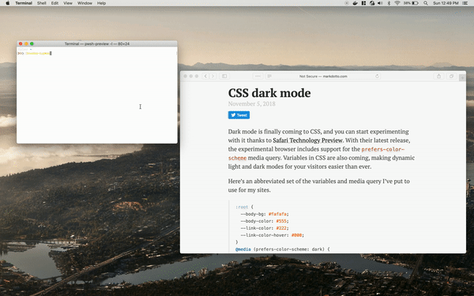

# PowerShell-Lumos

[](https://github.com/markwragg/PowerShell-Lumos/actions/workflows/build.yml)

[](https://www.powershellgallery.com/packages/lumos)
[](https://www.powershellgallery.com/packages/lumos)


A PowerShell module for switching Windows 10/11, macOS and Linux (GNOME) between light and dark themes depending on whether it is day or night.

> [!WARNING]
> **Breaking change for Windows users:** Lumos version 4.0+: Running `Invoke-Lumos` with no switches used to automatically pick Dark/Light based on your location and time of day on Windows. It now toggles to the opposite of whatever theme is currently active instead (matching the existing macOS behavior). Use the new `-Auto` switch to get the old automatic behavior back.
>
> If you previously ran `Register-LumosScheduledTask`, **re-run it** to re-create the scheduled task - the existing task was created using the old default behavior and won't pick up `-Auto` on its own.
>
> As of Lumos version 4.1, you can now run `Set-LumosDefault -Auto` to save `-Auto` as the default behaviour
> for `Invoke-Lumos`.

__Windows:__


__macOS:__



This module is published in the PowerShell Gallery, so can be installed via:

```PowerShell
Install-Module Lumos
```

## Usage

You can manually trigger Lumos as follows:

```PowerShell
Invoke-Lumos
```

On Windows, macOS and Linux (GNOME), using `Invoke-Lumos` with no switches will switch the theme to its alternate, i.e. if it's Light it will switch to Dark and if Dark switch to Light.

You can also simply use the alias `Lumos`.

You can explicitly specify whether you want the Dark or Light modes on Windows 10/11, macOS and Linux (GNOME) with the following switches:

```PowerShell
Invoke-Lumos -Dark

Invoke-Lumos -Light
```

Or you can have Lumos decide automatically, based on your location (determined from your public IP address) and whether it is currently before or after sunrise/sunset there:

```PowerShell
Invoke-Lumos -Auto
```

If the sun is down, the theme will be set to dark. If the sun is up, the theme will be set to light. `-Auto` works the same way on Windows, macOS and Linux.

By default the cmdlet will change both the System and Application themes, but on Windows 10/11 if you'd like to just change one of these you can exclude the other by using these switches:

```PowerShell
Invoke-Lumos -Dark -ExcludeSystem

Invoke-Lumos -Light -ExcludeApps
```
These switches are not available on macOS or Linux.

If you'd like your wallpaper to change with the theme (on Windows 10/11, macOS or Linux), you can specify a path to these:

```PowerShell
Invoke-Lumos -Dark -DarkWallpaper c:\wallpaper\dark.png

Invoke-Lumos -Light -LightWallpaper /Users/markwragg/Pictures/light.jpg
```

If you'd like change the theme of your Office ProPlus installation on Windows 10/11, you can pass the `-IncludeOfficeProPlus` flag. It will update your Office Clients to switch to either the Dark or Light mode. Note that it requires a restart of your Office Applications before it takes effect.

```PowerShell
Invoke-Lumos -Dark -IncludeOfficeProPlus
```

On Windows, when the System theme changes, Lumos applies it to the taskbar by broadcasting the same `WM_SETTINGCHANGE`/`WM_THEMECHANGED` messages Windows' own Settings app sends, rather than restarting Explorer. This reliably updates the taskbar, Start and Action Center, but **not** the chrome of any File Explorer windows you already had open - that appears to be a genuine Windows 11 limitation rather than something Lumos is missing (Microsoft's own PowerToys "Light Switch" module does the same broadcast and has the same [open, unresolved issue](https://github.com/microsoft/PowerToys/issues/42463)). If that bothers you, add `-RestartExplorer` to fall back to restarting Explorer instead, which does pick up existing windows:

```PowerShell
Invoke-Lumos -Dark -RestartExplorer
```

On Linux, Lumos currently only supports the GNOME desktop (the default on Ubuntu, Fedora, Debian and others), switching the theme via `gsettings org.gnome.desktop.interface color-scheme`. If `gsettings` isn't found, `Invoke-Lumos` throws rather than silently doing nothing. Other desktop environments (KDE, XFCE, etc.) aren't currently supported.

## Defaults

If you find yourself passing the same switches to `Invoke-Lumos` every time, you can save them as defaults instead, so you don't have to specify them again:

```PowerShell
Set-LumosDefault -Auto -RestartExplorer -DarkWallpaper c:\wallpaper\dark.png -LightWallpaper c:\wallpaper\light.png
```

`Invoke-Lumos` then uses these automatically whenever the corresponding switch isn't explicitly specified - explicitly passing a switch (e.g. `Invoke-Lumos -RestartExplorer:$false`) always overrides the saved default for that call. You can save a default for `-Auto`, `-ExcludeSystem`, `-RestartExplorer`, `-IncludeOfficeProPlus`, `-ExcludeApps`, `-DarkWallpaper` and `-LightWallpaper`.

You can view your currently saved defaults with:

```PowerShell
Get-LumosDefault
```

And remove them all, restoring the module's built-in behavior, with:

```PowerShell
Set-LumosDefault -Reset
```

Defaults are saved to a `.lumos` folder in your user profile directory (`~/.lumos`), so they survive a module upgrade.

## Scheduling

If you'd like Windows 10/11 to automatically switch from Light to Dark mode based on your local sunrise/sunset times, you can use the following cmdlet to add a Scheduled Task to do so (this cmdlet does not currently support macOS or Linux):

```PowerShell
Register-LumosScheduledTask
```

This registers a "Lumos" scheduled task that runs `Invoke-Lumos` twice a day, at your local sunrise and sunset, plus a second "Lumos-Maintenance" task that runs once a week to keep those times current as sunrise/sunset drift through the year. Both tasks run as your own (non-administrator) user account.

You can specify any of the `Invoke-Lumos` switches above when registering the task to customize the result. For example:

```PowerShell
Register-LumosScheduledTask -ExcludeApps -DarkWallpaper c:\wallpaper\dark.png -LightWallpaper c:\wallpaper\light.png
```

If you'd rather not have Lumos look up your location, you can specify fixed daily times yourself with `-Sunrise`/`-Sunset`, or reuse whatever schedule Windows' own Night Light feature (Settings > System > Display > Night light) is already configured with via `-FromNightLight`. Since neither of these needs to be kept in sync with the season, the "Lumos-Maintenance" task isn't registered in either case (and is removed if one was already registered from a previous, non-fixed run) - re-run the cmdlet if you want to pick up a later change:

```PowerShell
Register-LumosScheduledTask -Sunrise '07:00' -Sunset '19:00'

Register-LumosScheduledTask -FromNightLight
```

`Register-LumosScheduledTask` returns the scheduled task(s) it registered, showing the source and times that were used, so you can confirm what was set up:

```
TaskName           Source       Schedule                           State
--------           ------       --------                           -----
Lumos              Location     Light 07:00, Dark 19:00            Ready
Lumos-Maintenance  Location     Weekly Wednesday 13:00             Ready
```
